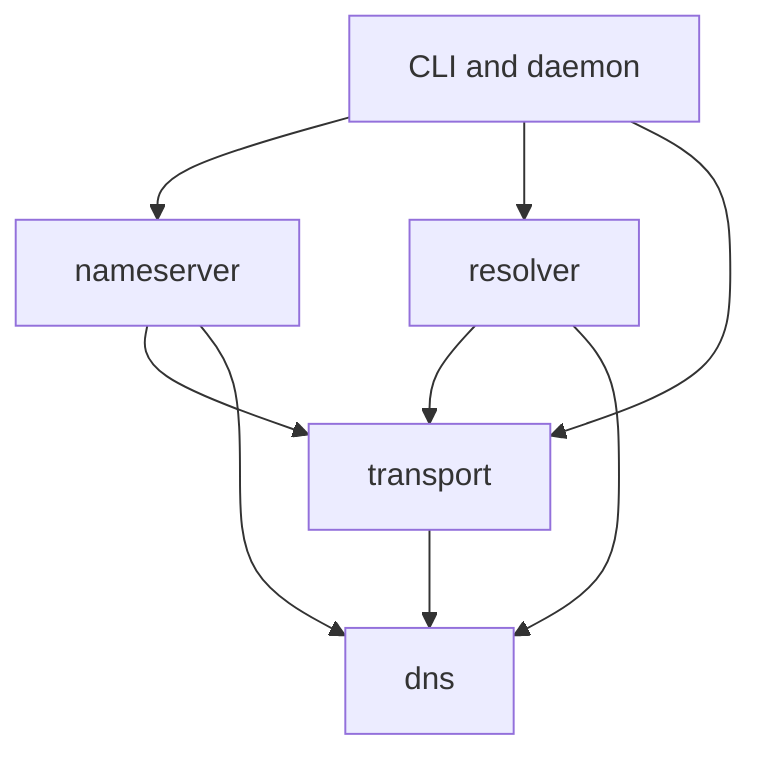

# Architecture and embedding

The reusable implementation lives in four crates. The root `donna` package
composes those crates into a client and daemon; it is not a library facade.
All four library crates deny missing public API documentation. Build the API
reference with `cargo doc --workspace --all-features --no-deps` and open
`target/doc/dns/index.html`, `transport/index.html`, `resolver/index.html`, or
`nameserver/index.html` relative to `target/doc/`.



## Data and wire representation

[`dns`](../crates/dns/src/lib.rs) owns `DomainName`, `Question`, `Message`,
`ResourceRecord`, typed `RData`, and DNS security types. Names retain label
octets, including escaped binary data. DNS name equality differs from ordinary
byte equality; use DNS-aware comparisons where protocol semantics require them.

`master::MasterFile` parses strings or files and resolves includes.
`Zone::from_master` additionally checks authoritative-zone invariants.
`wire::FromWire` and `IntoWire` decode and encode complete values. The wire layer
handles compression, section counts, bounded record parsing and prepared replies.
Unknown types retain opaque bytes and use RFC 3597 presentation syntax. Opaque
support does not provide type-specific validation or synthesis.

Persist independent complete wire values when storing records. Compression
pointers belong to the encoded value's original message context; an arbitrary
slice from a packet is not necessarily an independently decodable record.

## Transport and reply ownership

[`transport`](../crates/transport/README.md) owns framing, authenticated sessions,
query correlation and listener I/O. `Transport::exchange` performs an exchange.
`TransportServer` delivers `DnsRequest` to `DnsRequestHandler`; the request owns
a single-use capability to reply on the accepting connection or socket. Calling
`respond`, `respond_all`, or `respond_stream` consumes that capability.

A listener's response path is independent of the resolver's outbound route.
`UdpTransport` performs required TCP transitions for oversized/truncated DNS.
`TransportRoute` expresses additional application policy, such as an I/O-failure
fallback. Do not implement protocol-required fallback as an optional policy.

The immediate handling methods allow cached or authoritative answers without
creating asynchronous resolution work. Checked encoded UDP replies retain
correlation, size and TTL checks. Applications returning custom replies must
preserve the handler and wire contracts, not merely emit decodable packets.
Detailed limits, cancellation behavior and transfer mechanics are documented in
the [transport crate](../crates/transport/README.md).

Transport features default to empty:

| Feature | Additional behavior |
| --- | --- |
| `udp` | UDP client/listener and required `tcp` fallback; Linux batch I/O support. |
| `tcp` | Persistent framed DNS streams and AXFR. |
| `tls` | TLS 1.3 DoT; includes TCP framing and transfer support. |
| `doh` | HTTP/2 HTTPS GET/POST; does not require TCP DNS framing. |
| `doq` | QUIC streams; includes common TCP framing code. |
| `dnscrypt` | DNSCrypt v2 UDP/TCP; includes TCP. |

The root CLI enables every transport. A library consumer can enable only the
protocols it needs. The workspace patches `quinn-proto`; preserve or deliberately
replace that patch when integrating DoQ outside this workspace. Its exact scope
is recorded in [README.donna](../vendor/quinn-proto/README.donna).

## Resolver ownership and caches

[`Resolver<T>`](../crates/resolver/src/resolver/mod.rs) owns iterative policy and
state across questions. `RecursiveServer<T>` adapts it to inbound requests.
`Forwarder<T>` instead sends recursive queries to ordered upstreams. Reuse an
instance for a persistent cache; constructing one for every request starts cold.

Iteration tracks referrals, glue scope, nameserver addresses, alias restarts,
DNSSEC provenance, retry budgets and deadlines. Concurrent identical work can be
coalesced. Positive, negative, delegation, authenticated DNSKEY, BAD and terminal
failure state have separate lifetime and coherence rules. CD mode and class
participate in security-sensitive cache scope. Failure state is locally timed;
it is not assigned a received RR TTL.

The default library configuration supplies root hints but no trust anchors.
Supply DNSKEY anchors to enable validation. The CLI supplies bundled anchors
unless validation is explicitly disabled. The default native capacity is 4096
entries per cache, not 4096 entries across the whole resolver.

There are two cache choices:

| Constructor/API | Ownership |
| --- | --- |
| `Resolver::new` | Native synchronous lookup, admission, eviction and retention. |
| `Resolver::with_cache_engine` | Application-owned per-entry cache algorithms and indexes. Donna retains DNS coherence, sealed provenance, current trust and original expiry checks. |

`CacheEngine` reads describe targeted predicates and return a consistent readset;
mutations are atomic and revision-checked. Revisions must not repeat after
deletion or restart. Complete missing-key and family predicates matter for
conflict detection. Entry authentication detects modification, not rollback of
an older authentic entry. Persistent expiry needs a trusted wall clock. A nonzero
native capacity does not impose an eviction policy on an external engine; zero
disables engine I/O. There is no hidden native cache that supplies state discarded
by the provider. Optional denial-candidate lookup does not implement complete
RFC 8198 synthesis.

Read the [adapter contracts](../examples/adapters/README.md) before writing a
provider. [Remote examples](../examples/adapters/remote/README.md) keep Redis and
PostgreSQL SDKs outside the core dependency graph.

## Authoritative publication

[`NameServer`](../crates/nameserver/src/server/mod.rs) owns installed zone
snapshots, authoritative selection, authentication, updates and transfers.
`Zone` holds validated records and immutable query/denial indexes. The daemon
installs master-file snapshots; the library also supports `ZoneStore` catalogs.

Updates require durable publication and explicit identity/name/type grants.
Built-in storage uses `UpdatePersistence` before making a change visible;
custom `ZoneStore` implementations own atomic catalog durability. Do not return
success before a change can survive the promised failure model. A disconnected
client does not cancel a server commit once publication work has started.

`NameServerConfig` supplies transfer networks, TSIG/SIG(0) keys, update rules,
NOTIFY policy and bounded IXFR history. Defaults deny transfers and updates,
disable NOTIFY and retain no IXFR deltas. Primary publication and incremental
transfer history do not constitute a secondary refresh service.

## Embedding examples

Donna is distributed as a complete source checkout, not as individual crates.io
packages. The CLI and four libraries set `publish = false`; the generic local
package names do not identify Donna packages in the registry. Keep the `crates/`
and `vendor/` directories together when archiving or integrating a revision.
Use local path dependencies:

```toml
[dependencies]
dns = { path = "/path/to/donna/crates/dns" }
transport = { path = "/path/to/donna/crates/transport", features = ["udp"] }
resolver = { path = "/path/to/donna/crates/resolver" }

[patch.crates-io]
quinn-proto = { path = "/path/to/donna/vendor/quinn-proto" }
```

Put the patch in the consuming application's workspace-root manifest. Cargo
does not inherit a dependency workspace's `[patch]` table. It is required when
enabling `transport`'s `doq` feature, including when another dependency enables
that feature; otherwise the consumer silently uses the unpatched QUIC engine.
Retain the checkout's patch when copying examples into another workspace and
commit the consuming application's lockfile. The shipped example workspaces
demonstrate the same root-level patch.

An unsigned iterative query, using the default roots:

```rust
use dns::{ClassType, DomainName, QClassType, QueryType, Question};
use resolver::{Resolver, ResolverConfig};
use transport::UdpTransport;

async fn lookup() -> Result<dns::Message, Box<dyn std::error::Error>> {
    let resolver = Resolver::new(UdpTransport, ResolverConfig::default());
    let question = Question {
        qname: DomainName::from_dotted("example.com.")?,
        qtype: QueryType::AAAA,
        qclass: QClassType::Class(ClassType::IN),
    };
    Ok(resolver.resolve(question).await?)
}
```

Add a Tokio runtime to execute that function. Configure trust anchors before
using it as a validating resolver. The [recursive example](../examples/recursive/README.md)
shows anchor loading, listeners, custom roots and persistent resolver ownership.
The [authority example](../examples/authority/README.md) demonstrates complete
UDP/TCP service; [clients](../examples/clients/README.md) add encrypted endpoints.
The [update application](../examples/updates/README.md) shows authenticated grants,
restart persistence and NOTIFY. The [memory adapter](../examples/adapters/memory/README.md)
runs without sockets or external services.
